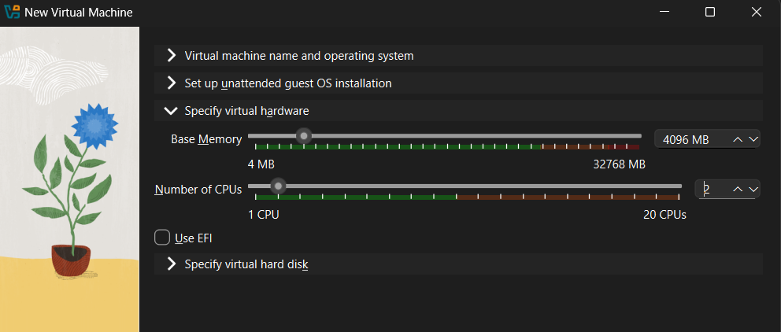

# Instalar tres sistemas gestores de base de datos
Para esta práctica, tendremos que tener una máquina virtual con estas características:

## 1. Desplegar Oracle Database 23ai Free con Podman
En primer lugar instalaremos Podman, Oracle Database se ejecuta en un contenedor administrado con Podman.

Comprobamos que se ha instalado correctamente:
