# Instalar tres sistemas gestores de base de datos
Para esta práctica, tendremos que tener una máquina virtual con estas características:
  
  
---
## 1. Desplegar Oracle Database 23ai Free con Podman
En primer lugar instalaremos Podman y descargaremos la imagen, Oracle Database se ejecuta en un contenedor administrado con Podman.  
  
Creamos el contendor con la imagen de Oracle  
  
Comprobamos que se ha instalado correctamente:  
  
---
## 2. Creación del volumen y del contenedor
Creamos un volumen con nombre para conservar los datos de Oracle aunque se detenga o se recree el contenedor:
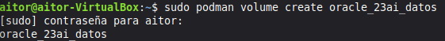  
A continuación, creamos el contenedor y publicamos el puerto TCP 1521:
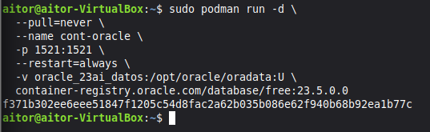  
Revisamos el contenedor:  
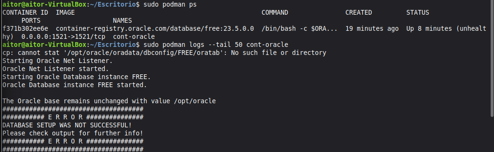  
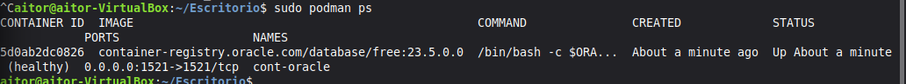  
---
## 3. Creación de usuario de trabajo en Oracle  
Accedemos a SQLplus con permisos de administrador, y comprobamos las bases de datos  
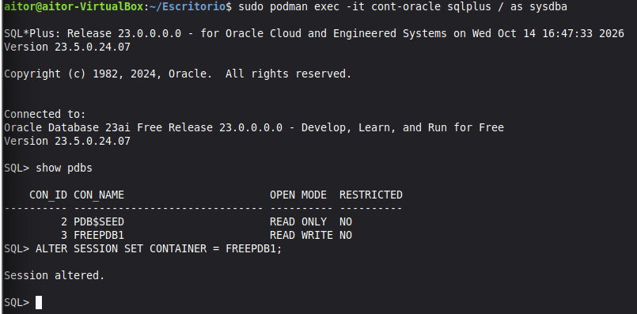  
Creamos el usuario orauser y le concedemos los permisos  
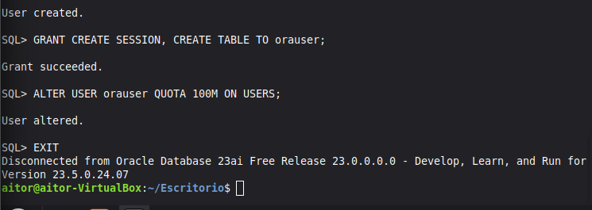  
Comprobamos la conexión:
*Incidencia con credenciales
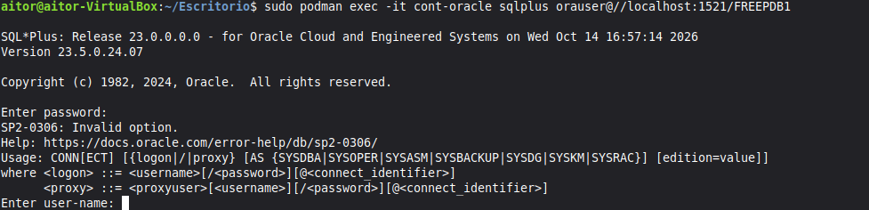  
---
## 4. Desplegar PostgreSQL
Instalamos postgreSQL y sus herramientas  
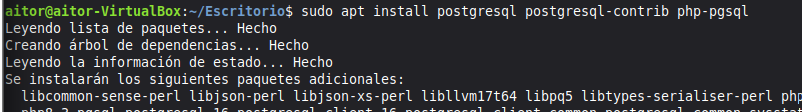  
Iniciamos el servicio y lo habilitamos para que inicie automáticamente, también comprobamos su estado  
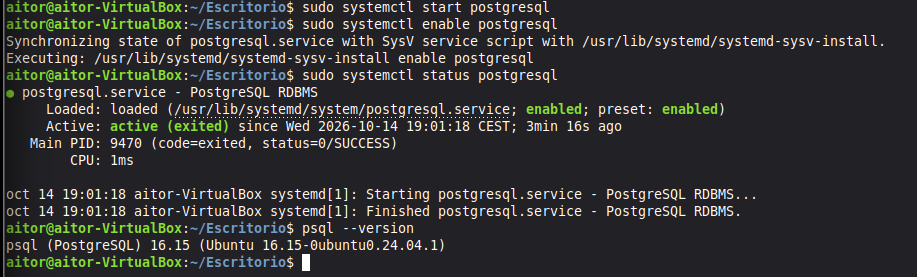  
Creamos la base de datos  
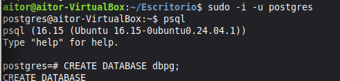  
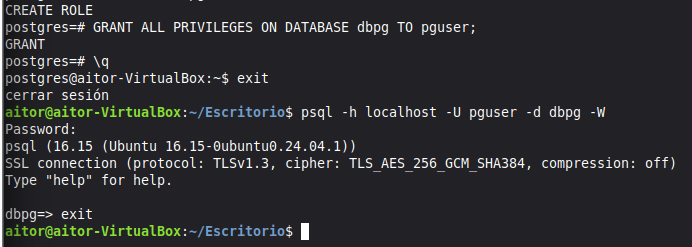  
**Para crear el usuario he usado el comando: CREATE USER pguser WITH PASSWORD con mi contraseña personal**  
---
## 5. Desplegar MariaDB
Instalamos Mariadb
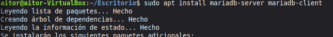  
Comprobamos que se ha instalado correctamente y habilitamos el servicio
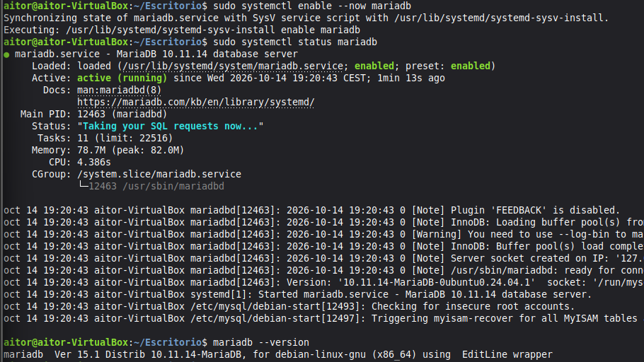  
Abrimos una sesión en MariaDB y creamos la base de datos dbm
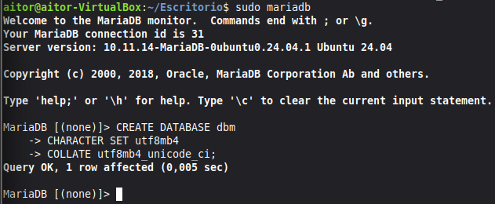  
Creamos el usuario con el comando **CREATE USER 'muser'@'localhost' IDENTIFIED BY 'contraseña';** y le concedemos los permisos  
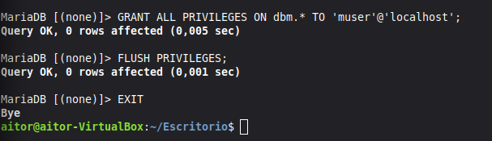  
Probamos la conexión  
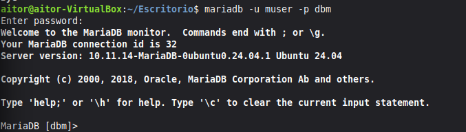  
-----------------------------------------------------------------------------
## 6. Comprobaciones  
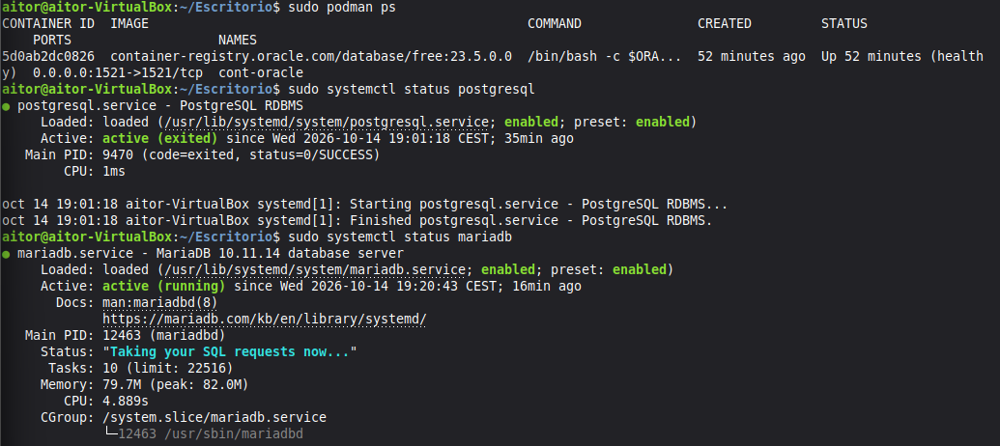 
